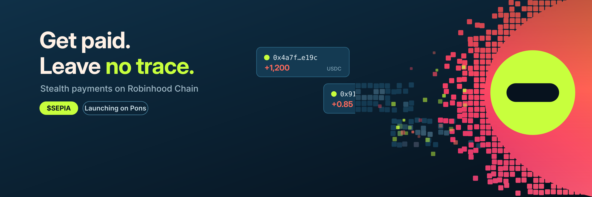
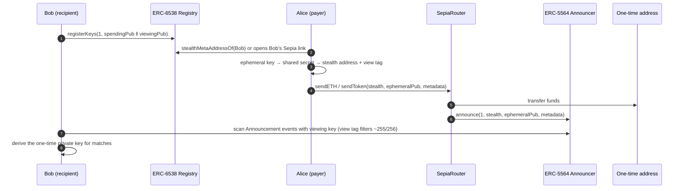
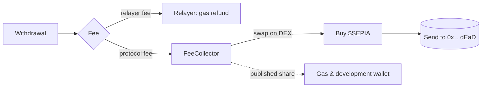

<p align="center">
  
</p>

<p align="center">
  <br>
  <b>Private payments on Robinhood Chain.</b><br>
  One link. A new address for every payment. Gasless withdrawals. Every fee burns <code>$SEPIA</code>.
</p>

<p align="center">
  <a href="https://x.com/sepia_rbh">X @sepia_rbh</a> ·
  <a href="docs/how-it-works.md">How it works</a> ·
  <a href="docs/architecture.md">Architecture</a> ·
  <a href="docs/privacy-model.md">Privacy model</a> ·
  <a href="ROADMAP.md">Roadmap</a>
</p>

> **Status: Phase 0 — pre-launch.** Contracts and SDK in this repo are work in progress, unaudited and **not deployed**. Do not send real funds to anything built from this code. The only official `$SEPIA` contract address is the one published on the website and on [@sepia_rbh](https://x.com/sepia_rbh).

---

## What Sepia does

On Robinhood Chain, like on every EVM chain, an address is a public ledger page. Share yours once and anyone can read your balance, your history and every wallet you have dealt with.

Sepia lets you **get paid without revealing your wallet**:

1. You publish one **stealth meta-address** (a link or QR).
2. Every payer's wallet derives a **fresh one-time address** from it. Nobody but you can tell that the address is yours.
3. You find your payments with a private **viewing key** and move the funds out through a **relayer**, so the one-time address never has to be funded from your main wallet.

Sepia is built on two open Ethereum standards: [ERC-5564](https://eips.ethereum.org/EIPS/eip-5564) (stealth addresses) and [ERC-6538](https://eips.ethereum.org/EIPS/eip-6538) (stealth meta-address registry). It is **not a mixer**: no contract pools users' funds, and every payment goes straight to an address that belongs to the recipient.

## How a payment flows



The cryptography in one line: `stealthPub = spendingPub + keccak256(ephemeralPriv · viewingPub) · G`. Only the holder of the viewing key can recompute the shared secret, and only the holder of the spending key can derive the private key. Full walkthrough in [docs/how-it-works.md](docs/how-it-works.md).

## Withdrawals: the hard part

A one-time address starts with no ETH for gas. Funding it from your main wallet would link the two on-chain. Sepia handles this per asset:

| Asset received | How it leaves the one-time address | Who pays gas |
| --- | --- | --- |
| **ETH** | The one-time address sends `SepiaRouter.sweepETH` itself | Paid out of the received ETH |
| **Tokens with EIP-2612 `permit`** (e.g. USDC, if the deployed version supports it) | The one-time key signs a permit + a withdraw intent off-chain; the relayer submits `withdrawWithPermit` | Relayer, repaid from the amount |
| **Other ERC-20** (most Pons tokens) | The relayer tops up a tiny amount of gas, then the one-time address sweeps the tokens | Relayer, repaid in the token |

Every withdrawal is bound by an EIP-712 signature from the one-time key: the relayer cannot change the destination, the amount or raise the fee. Details and threat notes in [docs/withdrawals.md](docs/withdrawals.md).

## Fees and $SEPIA



- Protocol fees are capped on-chain (`maxFeeBps`, hard cap 1%).
- `FeeCollector` swaps collected fees for `$SEPIA` and sends them to the dead address. Every burn emits `Burned(amountIn, sepiaBurned)`.
- `$SEPIA` launches on **Pons** with a fixed supply, so burns only reduce it.
- Holders get lower or zero relayer fees through a **tier pass** (see [docs/token.md](docs/token.md)). The trade-off involved is documented openly in [docs/privacy-model.md](docs/privacy-model.md#tier-passes).

## Repository layout

```
contracts/        Foundry project
  src/SepiaRouter.sol          send + announce in one tx; three withdrawal paths; fee cap
  src/FeeCollector.sol         buyback and burn of $SEPIA, published ops share
  src/interfaces/              ERC-5564 announcer, ERC-6538 registry, swap router
  test/SepiaRouter.t.sol       unit tests with mock announcer and tokens
  script/Deploy.s.sol          deployment script for Robinhood Chain
sdk/              TypeScript SDK (ERC-5564 scheme 1, secp256k1 with view tags)
  src/keys.ts                  derive spending + viewing keys from one wallet signature
  src/stealth.ts               generate a stealth address, check announcements, derive the private key
  src/metadata.ts              encode / decode announcement metadata
  examples/pay-and-scan.ts     end-to-end example: Bob publishes, Alice pays, Bob finds it
relayer/          relayer HTTP API spec (OpenAPI) and operating rules
docs/             protocol, architecture, withdrawals, privacy model, token
deployments/      addresses per network (empty until launch)
```

## Network

| | |
| --- | --- |
| Chain | Robinhood Chain (Arbitrum Orbit L2) |
| Chain ID | `4663` (`0x1237`) |
| Public RPC | `https://rpc.mainnet.chain.robinhood.com` (rate-limited) |
| Explorer | `https://robinhoodchain.blockscout.com` |
| ERC-5564 Announcer | canonical CREATE2 address `0x55649E01B5Df198D18D95b5cc5051630cfD45564` if available on the chain, otherwise our own deployment — see [deployments/](deployments/) |
| ERC-6538 Registry | canonical CREATE2 address `0x6538E6bf4B0eBd30A8Ea093027Ac2422ce5d6538` if available, otherwise our own deployment |

## Quick start (developers)

```bash
# contracts
cd contracts
forge install foundry-rs/forge-std OpenZeppelin/openzeppelin-contracts --no-commit
forge test -vv

# sdk
cd ../sdk
npm install
npm run example        # runs examples/pay-and-scan.ts locally, no chain needed
```

## Roadmap

| Phase | Name | Ships | Gate |
| --- | --- | --- | --- |
| 0 | Launch | `$SEPIA` on Pons, website, link reservation, this repo | Token live, CA verified |
| 1 | Private links | Registry, pay links + QR, ETH & USDC, scanner, relayer, buyback & burn | Security review + first real payments |
| 2 | Cashboxes | Tiers, any Pons token, recurring payments, team cashboxes, auditor keys | External audit published |
| 3 | Network | Relayer staking, open relayer client, SDK + checkout button, ZK research | Independent relayers live |

Full version with deliverables: [ROADMAP.md](ROADMAP.md).

## Security

Unaudited, not deployed. Please report vulnerabilities privately as described in [SECURITY.md](SECURITY.md), not in public issues.

## Disclaimer

`$SEPIA` is a community token with no claim on revenue, no ownership rights and no promise of profit. Sepia is not affiliated with Robinhood Markets. Nothing in this repository is financial or legal advice. Privacy tools are subject to local law; use Sepia only where it is legal for you to do so.

## License

[MIT](LICENSE)
