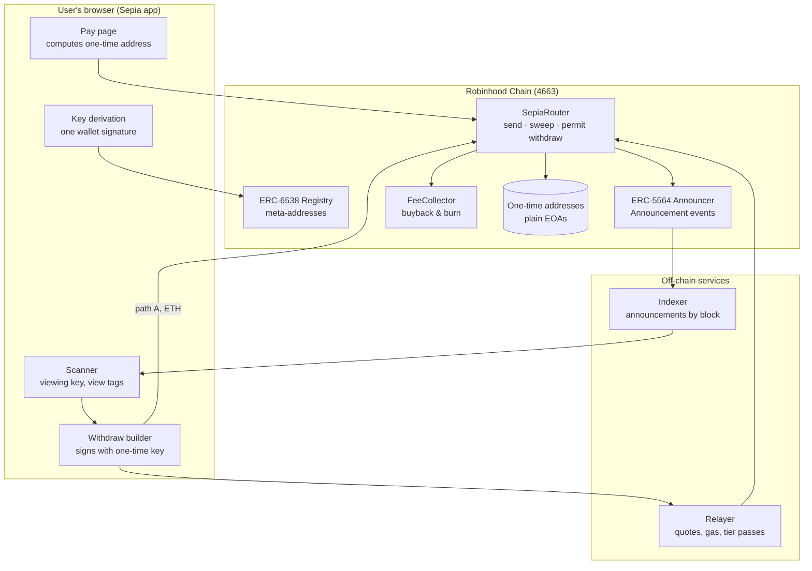

# Architecture

Sepia has four parts. Only two of them live on-chain, and none of them holds user funds between transactions.

## On-chain

| Contract | Source | Holds funds? | Upgradeable? |
| --- | --- | --- | --- |
| ERC-6538 Registry | canonical singleton, or reference deployment | No | No |
| ERC-5564 Announcer | canonical singleton, or [`ERC5564Announcer.sol`](../contracts/src/ERC5564Announcer.sol) | No | No |
| SepiaRouter | [`SepiaRouter.sol`](../contracts/src/SepiaRouter.sol) | Only inside a single transaction | No. A new version is a new address; the app switches. |
| FeeCollector | [`FeeCollector.sol`](../contracts/src/FeeCollector.sol) | Protocol fees, until the next burn | No; the swap adapter is replaceable |
| Swap adapter | [`adapters/UniswapV3Adapter.sol`](../contracts/src/adapters/UniswapV3Adapter.sol) | No | Replaced by setting a new adapter |

Owner-only functions (fee cap, fee collector address, adapter, ops share) are held by a multisig. Hard ceilings are constants in code: the protocol fee can never exceed **1%**, the ops share can never exceed **30%** of fees.

## Off-chain

**Indexer.** Reads `Announcement(schemeId = 1)` events and serves them in pages by block range. It sees nothing private: announcements are public. The app can use our indexer, any public Blockscout API, or a direct RPC log query.

**Scanner.** Runs in the user's browser. Downloads announcements, applies the view tag filter, and keeps the matches locally. The viewing key never leaves the device unless the user exports it.

**Relayer.** Quotes fees, submits permit withdrawals (path B), sends gas top-ups (path C), issues tier passes. API: [`relayer/openapi.yaml`](../relayer/openapi.yaml). Operating rules: [`relayer/README.md`](../relayer/README.md).

## Data the app stores

| Data | Where | Why |
| --- | --- | --- |
| Spending and viewing keys | Browser memory; optionally encrypted in local storage | Re-deriving needs a wallet signature each time |
| List of your one-time addresses | Browser local storage | So you see balances without rescanning |
| Last scanned block | Browser local storage | Incremental scans |
| Tier pass | Browser local storage, 24 h | Discounted quotes |

Nothing above is sent to Sepia servers. If you clear the browser, you sign the key message again and rescan.

## Dependencies on Robinhood Chain features

| Feature | Needed for | If missing |
| --- | --- | --- |
| Standard EVM + `ecrecover` | Everything | n/a |
| CREATE2 deployer at the usual address | Canonical announcer / registry addresses | We deploy our own copies |
| USDC with EIP-2612 `permit` | Gasless path B for USDC | USDC uses path C |
| EIP-7702 | One-transaction path C | Path C keeps the top-up flow |
| DEX liquidity for `$SEPIA` (Pons pools) | Buyback | Fees accumulate in FeeCollector until an adapter for the venue ships |
